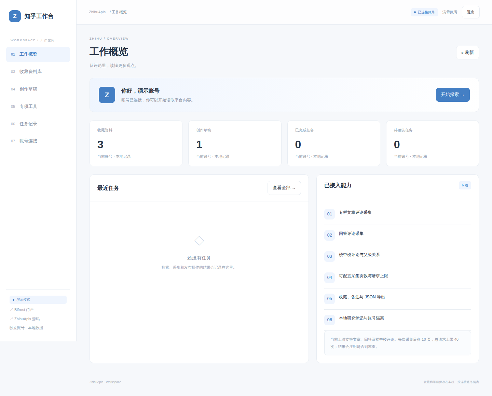

# zhihu

[](LICENSE)

独立运行的知乎工作台，基于 [cv-cat/ZhihuApis](https://github.com/cv-cat/ZhihuApis) 增加 Web 控制台。
包含文章和回答的评论采集、楼中楼评论、采集页数控制、收藏标签、资料导出和研究笔记。
Python 后端、原生 HTML/JS 前端、SQLite 数据库，无需 Bifrost 或前端编译。

## 界面预览

以下为本项目离线演示模式截图，账号和内容均为模拟数据。



## 一键启动

先安装 **Python 3.10+**，克隆仓库后运行：

```bash
git clone https://github.com/liuyishoua/zhihu.git
cd zhihu
python3 start.py
```

Windows 可双击 `start.bat`；macOS 可双击 `start.command`；Linux 可运行 `./start.sh`。
首次启动自动创建 `.venv`、安装 Python 依赖，成功后尝试打开 **http://127.0.0.1:8777**。
首次安装需要联网，后续依赖不变时直接启动。按 Ctrl+C 停止。

默认是**演示模式**，使用独立模拟账号和内容，不联系真实平台。
工作台访问密码保存在 `.local/web-demo/admin-password`；工作台登录与平台账号连接分别管理。

```bash
# 更换端口或在服务器上运行
python3 start.py --port 8877 --no-browser
```

## 真实账号模式

安装 **Node.js 20+**（平台签名辅助代码需要时使用），然后运行：

```bash
python3 start.py --real
```

使用网页 Cookie 连接。当前支持评论研究，不提供全站内容搜索或平台发布。
首次运行的访问密码保存在 `.local/web/admin-password`，进入后连接自己的平台账号。
真实能力受登录状态、账号权限和平台接口返回影响；演示运行成功不代表真实平台业务已经联调。
模型起草与分析由可选 Channel 接入提供，普通查询无需部署 Channel。

## 数据与备份

- 演示数据：`.local/web-demo/`；真实工作台数据：`.local/web/`。
- 账号会话、Cookie、访问密码、数据库和上传素材只保存在本地。
- 收藏、标签、备注和草稿按平台账号隔离，保存草稿不会自动发布。
- 真实写入使用请求 ID 去重；结果不确定时不自动重试。
- 备份前停止服务，复制整个 `.local/`；数据、`.env`、密钥和虚拟环境不提交 Git。

## 手动安装与验证

```bash
python3 -m venv .venv
# Linux / macOS；Windows 使用 .venv\Scripts\python.exe
.venv/bin/python -m pip install -r requirements-web.txt
.venv/bin/python -m web --demo
.venv/bin/python -m unittest discover -s web/tests -v
node --check web/static/app.js
```

真实模式如存在根目录 `package.json`，还需安装 Node.js 依赖；一键启动会在依赖目录缺失时执行 `npm install`。
不要运行上游示例脚本作为工作台入口，它们可能输出登录态或执行真实平台操作。

## 目录

- `web/`：HTTP 服务、业务逻辑、平台适配、前端和回归测试。
- `docs/workspace.md`：功能范围、接口与部署说明。
- `deploy/`：systemd 和 HTTPS 反向代理示例，部署时调整域名及本机路径。
- `start.py`、`start.sh`、`start.command`、`start.bat`：一键启动入口。
- 其余平台接口、签名资源及原始例程保留原有来源标注。

原项目说明保存在 [docs/upstream-readme.md](docs/upstream-readme.md)。

## 使用许可

**本项目仅供学习、研究、测试及其他非商业用途，不得用于商业目的。**
对本仓库中版权所有者拥有权利的代码，采用
[PolyForm Noncommercial License 1.0.0](LICENSE)；商业使用须事先取得版权所有者的单独授权。
本项目属于**源码可见、限制商用**，不应标为 MIT 或 OSI 意义上的开源许可证。

第三方代码、素材和依赖仍受其各自许可条件约束，来源与许可范围见
[THIRD_PARTY_NOTICES.md](THIRD_PARTY_NOTICES.md)。本声明不追溯改变第三方代码或此前已发布版本的许可。
